<div align="center">

# Design-Based CD and EPE Metrology from Low-Dose SEM Images

### Measuring nanometre-scale chip features from fast, low-dose electron-microscope images, with a quantified error budget on simulated ground truth and evaluation on two real SEM datasets: wafer defects and integrated-circuit wiring


[](LICENSE)

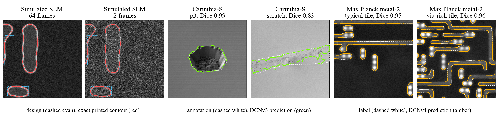

<sub>Simulated SEM at 64 and 2 frames (design and exact printed contour) · Carinthia-S wafer defects (DCNv3) · Max Planck metal-2 wiring (DCNv4)</sub>

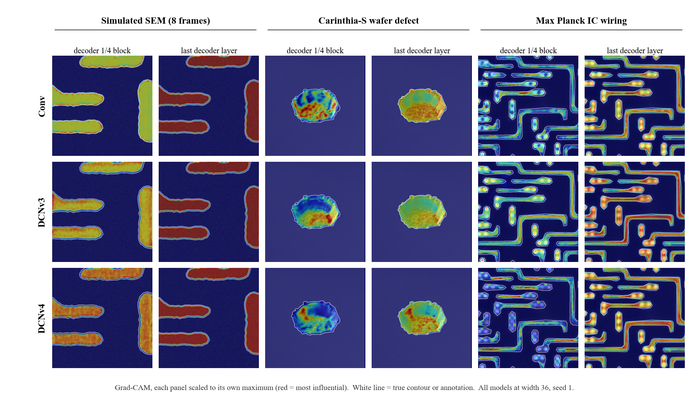

<sub>Where the networks look: Grad-CAM of the standard-convolution, DCNv3 and DCNv4 U-Nets on the same three data sources (details in <a href="#8--explainability-e11">Section 8</a>).</sub>

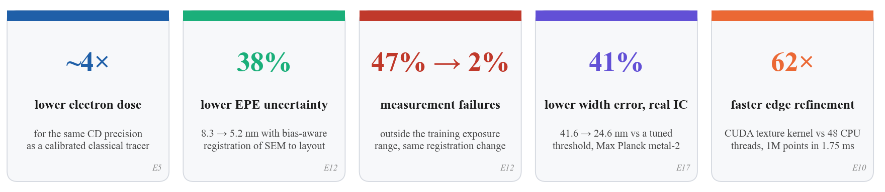

| Result | Value | Exp. |
|---|:--:|:--:|
| Dose needed to match the classical tracer's 64-frame CD precision | **14–17 frames (~4× lower)** | E5 |
| EPE uncertainty, design-template → bias-aware registration | 8.3 → **5.2 nm** (−38%) | E12 |
| CD failures outside the training exposure range | 47% → **2%** | E12 |
| Track-width error on real IC wiring, threshold baseline → learned model | 41.6 → **24.6 nm** | E17 |
| Edge refinement, 10⁶ points on a 4096 px image | **1.75 ms** (62× vs 48 CPU threads) | E10 |
| Deformable vs standard convolution at equal width | no gain on simulation; small, dataset-dependent gain on real SEM | E16, E17 |

**[Overview](#overview)** · **[Contributions](#research-contributions)** · **[Practical significance](#practical-significance)** · **[Implications](#implications)** · **[Research approach](#research-approach)** · **[Open questions](#open-research-questions)** · **[Technical report](#technical-report)** · **[Reproduce](#11--reproduction)**

</div>

---

## Overview

**Problem.** CD-SEM tools measure the printed dimensions of chip features and limit the throughput of process control. Lower electron dose is faster and damages the resist less, but yields noisier images. The research question is how much dose a better measurement algorithm can save without losing accuracy, and which error sources remain once noise is controlled.

**Approach.** An end-to-end, design-based metrology engine. It registers the SEM image to the chip layout, extracts sub-pixel contours with a deep-learning model or a calibrated classical tracer, measures CD and edge placement error (EPE) at layout-defined sites, flags unreliable measurements, and runs the edge-refinement step in a custom CUDA kernel. A physics-motivated SEM simulator provides **exact nanometre ground truth**, so every error source can be measured rather than estimated. Two real SEM datasets check that the conclusions hold beyond simulation.

**Findings.** Across 16 completed experiments (E1–E17; the Monte Carlo check E15 is deferred), six of them pre-registered:
- The learned model matches the classical tracer's 64-frame precision at **about a quarter of the dose**.
- **Registration to the layout, not the edge model, is the largest error source for EPE**, and a new bias-aware registration cuts EPE uncertainty by **38%**.
- The remaining accuracy floor is an edge-calibration offset that only reference metrology can remove.
- Newer, more complex network operators (deformable convolutions) bring **no measurable benefit on simulated metrology** and only a small, dataset-dependent gain on real images.

<div align="center">
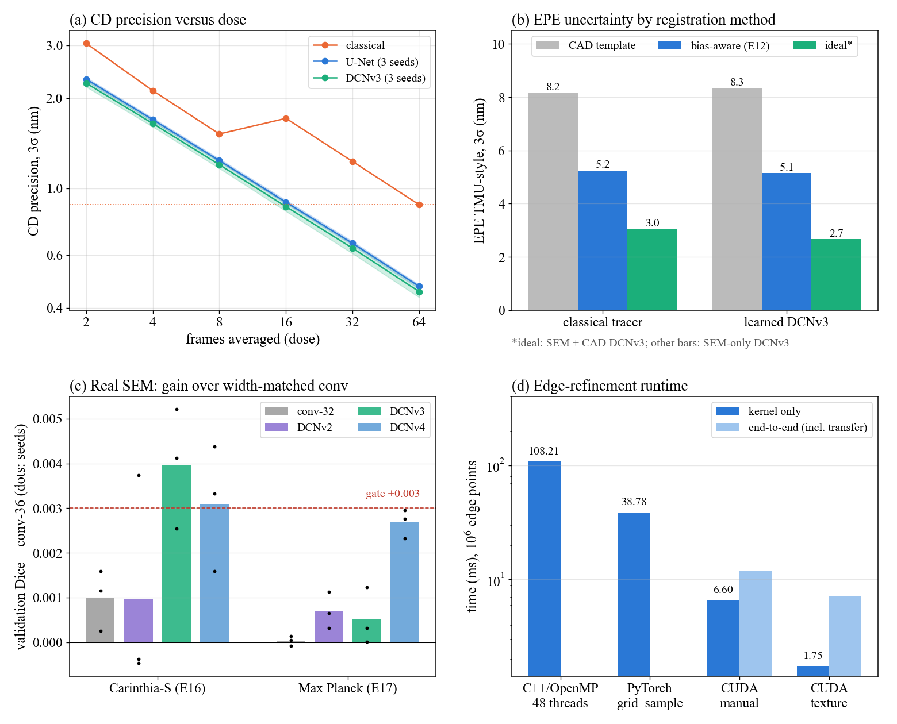

<sub><b>Figure 1.</b> (a) CD precision against dose; bands span three training seeds. (b) EPE uncertainty for three registration methods. (c) Real-SEM gain of each deformable operator over a width-matched standard convolution; dots are seeds, the dashed line is the pre-registered acceptance threshold. (d) Edge-refinement runtime.</sub>
</div>

## Research contributions

1. **A metrology benchmark with exact ground truth.** An SEM forward model on public lithography layouts produces images together with their exact printed contours. Bias, sensitivity, precision and total uncertainty can therefore be measured directly, which real SEM data cannot provide.
2. **An error budget for design-based metrology.** Controlled experiments separate the three error sources. Shot noise is addressed by learned contours (~4× dose), registration by the new bias-aware method (EPE −38%), and the remaining floor is identified as a per-image edge-calibration offset (91% of CD error variance, r = −0.98 with the simulated bloom offset).
3. **Bias-aware registration.** Registration jointly estimates translation and global edge bias. It removes nearly all failures under process drift and, as a by-product, estimates the exposure shift.
4. **A controlled study of deformable convolutions for metrology.** Four operators were compared at matched parameters and then at matched width, with a width-only control, three seeds, and evaluation on simulated data and two real datasets. The result is a well-bounded negative finding: the benefit is small and dataset-dependent.
5. **A GPU edge-refinement kernel.** A C++/CUDA implementation with a float64 parity analysis, showing both the speed-up (62×) and the precision limit of hardware texture filtering.

## Practical significance

The results translate into concrete properties of a measurement system:

| Aspect | Result | Consequence |
|---|---|---|
| **Throughput** | Same CD precision at **14–17 instead of 64 frames** | Up to ~4× shorter image acquisition per site, or ~4× less electron dose per site (less resist shrinkage) |
| **Edge placement control** | EPE uncertainty **8.3 → 5.2 nm** | Tighter monitoring of pattern placement against the design |
| **Robustness to process drift** | Failures outside the calibrated exposure range **47% → 2%**; the estimated edge bias tracks the true exposure shift to within 1.4 px | Measurements stay valid when the process drifts, and the same step doubles as an exposure monitor |
| **Compute cost** | Edge refinement **62× faster** than a 48-thread CPU (10⁶ points in 1.75 ms) | Real-time measurement on a single GPU |
| **Model complexity** | Deformable operators and design (CAD) input were tested under pre-registered gates | Neither is needed for simulated metrology; simpler models suffice |

## Implications

What the evidence supports for anyone building a similar system:

| Question | Conclusion | Evidence |
|---|---|:--:|
| Edge model | A learned contour model (SEM-only input) outperforms a calibrated classical tracer at low dose | E5, E6 |
| Registration | Bias-aware registration gives the largest single improvement and should precede any model change | E12 |
| Design as model input | Feeding the layout to the network brings no accuracy gain and under-reports real changes | E6 |
| Remaining accuracy floor | Requires calibration of the edge offset against reference metrology (cross-section TEM or AFM); estimated CD 3σ 5.6 → 1.7 nm | E13 |
| Network operator | Standard convolution is sufficient and fastest for metrology. DCNv4 is the only deformable option with a consistent, though small, real-SEM gain | E16, E17 |
| Roughness reporting | Learned contours under-report LER by about 5% and need a calibrated correction | E7, E14 |
| Validation still missing | Real CD-SEM data with reference metrology, and a Monte Carlo SEM simulation (E15) | – |

## Research approach

The project is run as a sequence of falsifiable experiments rather than as a single model-tuning effort.

| Practice | How it is applied here |
|---|---|
| **Hypothesis first** | Each follow-up experiment (E11–E17) starts from a measured observation, states one hypothesis and changes one component |
| **Pre-registration** | Metrics and numerical acceptance gates are committed to [docs/ROADMAP.md](docs/ROADMAP.md) before the run; failed gates are reported, never relaxed |
| **Clean evaluation** | Model selection on validation only; each frozen configuration is evaluated once on held-out test layouts |
| **Controls and confounds** | The equal-width study (E16) adds a width-only control to separate capacity from operator type; CAD vs SEM-only isolates design leakage (E6) |
| **Statistical care** | Paired bootstrap confidence intervals, two to three training seeds, and gates that require a gain on every seed |
| **Negative results** | Of the five gated experiments, three failed outright (E13, E14, E17) and one in part (E16 on simulated data); all are reported in full, with their implications |
| **Self-correction** | An error in the first explainability analysis (an empty score on contact tiles) was found, fixed and the published numbers corrected |
| **External validity** | Conclusions are checked on two independent real SEM datasets, with their limitations stated explicitly |
| **Reproducibility** | One command rebuilds E1–E10 from public data, and the listed scripts rebuild E11–E17; 49 automated tests; seeded simulation |

**Technical scope:** physical image modelling (SEM forward model, noise, blur, distortion); computer vision and deep learning (U-Net, deformable convolutions, TSDF regression); metrology statistics (precision, TMU, regression slope, bootstrap); explainability (Grad-CAM, offset analysis); high-performance computing (C++/OpenMP, CUDA, pybind11); and research engineering (GPU job queue, configuration-driven runs, test suite).

## Open research questions

| Question | Why it matters | Proposed next experiment |
|---|---|---|
| Can the per-image edge offset be calibrated without destructive reference metrology? | It is the dominant remaining CD error (est. 5.6 → 1.7 nm if removed) | Calibration from a small set of reference sites (TEM/AFM) with transfer to new patterns |
| Do the conclusions hold under physically simulated electron scattering? | The forward model is controlled, not physical | Monte Carlo SEM simulation (E15) on the same layouts |
| Where in the network does deformable sampling help, if anywhere? | The real-SEM gain is small and not explained by the attention maps | Deformable blocks only at high-resolution levels, plus a zero-offset control |
| What is the accuracy/latency trade-off on production hardware? | Deformable operators currently run through reference implementations | Compiled kernels and batch-latency benchmarks at equal width |
| Do results transfer to real CD-SEM with reference measurements? | Both real datasets are segmentation benchmarks | Evaluation on resist CD-SEM data with CD-AFM or TEM reference values |

---

<a id="technical-report"></a>

# Technical report

The sections below give the full method, protocol and results for every experiment. Detailed result sections are collapsed; each heading states its main finding.

## 1 · Background

In semiconductor manufacturing, a CD-SEM measures the printed dimensions of features on the wafer. **Design-based metrology** places the measurement sites (gauges) from the design layout: the SEM image is registered to the layout, the printed contour is extracted, and dimensions are measured at the design-defined locations. Three quantities determine whether such a measurement is useful. **Precision** is the repeatability under noise. **Accuracy** is the agreement with the true value, including systematic bias. **Sensitivity** is whether a real change on the wafer is reported at its full magnitude.

Lowering the electron dose (averaging fewer frames) increases throughput and reduces resist damage, but increases shot noise. The central question is therefore how much dose a better edge model saves without sacrificing accuracy. A segmentation score such as Dice cannot answer this: a model can segment well and still be biased or insensitive to process change. For that reason, the simulated experiments report metrology metrics against exact truth.

| Term | Meaning |
|---|---|
| **CD** (critical dimension) | Printed width of a line, space or contact |
| **EPE** (edge placement error) | Signed distance between a design edge and the corresponding printed edge |
| **Frames / dose** | Number of averaged SEM scans; fewer frames mean lower dose and more noise |
| **Precision (3σ)** | Three times the standard deviation of repeated measurements of the same feature under independent noise |
| **TMU-style uncertainty** | Three times the residual scatter of measured against true values after a linear fit; combines precision and feature-dependent error |
| **Slope** | Regression slope of measured against true values; below 1 means real changes are under-reported |
| **Failure rate** | Fraction of gauges with no valid measurement or an error above 10 nm |
| **Registration** | Alignment of the SEM image to the design layout before measurement |

## 2 · Method

### 2.1 Measurement pipeline

The engine turns one SEM image and the corresponding layout clip into a list of dimensional measurements, each with a validity flag. The system diagram below shows how the components connect. Figure 2 then follows a single validation tile through the five measurement steps. In the simulated experiments the exact printed contour is also known, so every measurement can be scored against truth.

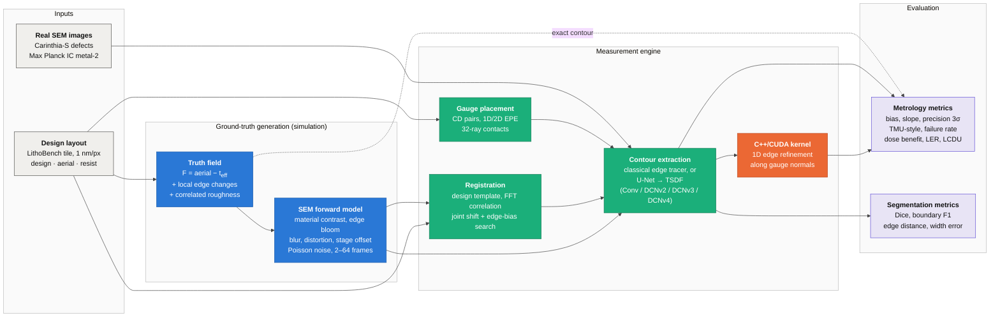

<sub><b>System overview.</b> Grey: inputs. Blue: ground-truth generation, used only for the simulated experiments. Green: the measurement engine, identical for simulated and real images. Orange: the GPU kernel. Purple: evaluation. On simulated data, the exact contour from the truth field scores every measurement. On real SEM data, which has no CD truth, the contour model is scored against annotations.</sub>

<div align="center">
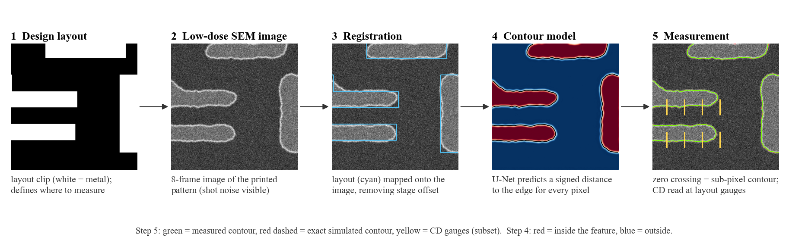

<sub><b>Figure 2.</b> The measurement pipeline on one simulated validation tile at 8 frames. Panels 2–5 use the same image; panel 4 is the actual output of the trained SEM-only DCNv3 model.</sub>
</div>

| Step | Input → output | What happens and why |
|:-:|---|---|
| **1. Layout** | GDS clip → binary design image | The design defines *what* should be measured: straight segments become CD gauges, edges become EPE probes and contacts become 32-ray gauges. Gauges are placed away from corners, where the printed shape legitimately deviates from the design. |
| **2. Image** | Wafer → SEM image at 2–64 frames | A low frame count shortens acquisition and reduces dose, at the cost of shot noise. Edges appear as bright "bloom" lines whose peak does not coincide with the physical edge, which is why an edge model is needed. |
| **3. Registration** | Image + layout → transform from design to image coordinates | The layout is rendered as an expected SEM image and aligned by FFT cross-correlation, removing stage offset and scan distortion. The bias-aware variant (E12) also searches over a global edge bias, so the template still matches when the exposure makes every feature wider or narrower. This step decides where each gauge lands, which makes it the dominant EPE error source (E5). |
| **4. Contour model** | Image → signed distance to the nearest edge, per pixel | A U-Net regresses a truncated signed distance function (TSDF): positive inside features, negative outside. Regressing distance rather than a class label gives a smooth field whose zero crossing can be located to a fraction of a pixel. The classical alternative locates the bloom peak and an outer-slope threshold with a calibrated offset. |
| **5. Measurement** | Contour + gauges → CD and EPE in nm, plus validity | Along each gauge normal, the zero crossing of the TSDF gives the edge position. The classical path instead searches the 1D intensity profile along the normal, the step accelerated by the C++/CUDA kernel; applying that refinement on top of the learned contour made it worse (E4). CD is the distance between paired edges, EPE the signed offset from the design edge. A gauge fails when no valid crossing exists or the error exceeds 10 nm. |

**Ground truth.** In the simulator, the printed contour is the zero level set of a continuous field derived from the LithoBench aerial image. The same field generates the SEM image (Figure 3), so the true edge position is known to sub-nanometre precision. The process is perturbed with an exposure-like threshold sweep (CD changes of ±12 nm in training and ±21 nm held out), local edge displacements and correlated roughness. Measurement accuracy, sensitivity to real changes and precision under noise can therefore all be computed exactly.

**Components.**

| Stage | Description | Code |
|---|---|---|
| Ground truth | The printed contour is the zero level set of a continuous field derived from the LithoBench aerial image. An exposure-like threshold sweep produces pattern-dependent CD changes (±12 nm in training, ±21 nm held out); local edge perturbations and correlated roughness are added. | `src/sem_sim.py` |
| SEM forward model | Material contrast, edge bloom with a per-image offset, Gaussian beam blur, low-order distortion, stage offset, Poisson shot noise for 2–64 frames and detector noise. GPU-batched and seeded, so images and truth are exactly reproducible. | `src/sem_sim.py` |
| Registration | Renders the layout with the nominal SEM model and aligns it by FFT cross-correlation. The bias-aware variant (E12) also searches for a global edge bias. | `src/registration.py` |
| Gauges | Paired CD on straight segments, 1D/2D EPE along design normals, 32-ray contact gauges; GDS export. | `src/gauges.py` |
| Classical baseline | Gaussian filtering, bloom-peak search and outer-slope threshold, tuned per dose on validation data, with a calibrated edge offset. | `src/classical.py` |
| Learned model | U-Net predicting a truncated signed distance map (TSDF) of the printed contour; the zero crossing gives a sub-pixel edge. | `src/models.py`, `src/operators.py` |
| Edge kernel | 1D edge refinement in C++/OpenMP and CUDA (manual bilinear and hardware texture sampling), exposed through pybind11. | `cuda/` |

<div align="center">
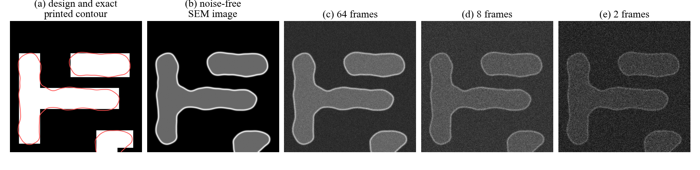

<sub><b>Figure 3.</b> Simulator output for a second validation tile: (a) design with the exact printed contour, (b) noise-free SEM image, (c–e) the same field at 64, 8 and 2 frames.</sub>
</div>

### 2.2 Model architecture

All learned models share one U-Net (Figure 4). The network has four resolution levels with *w*, 2*w*, 4*w* and 8*w* channels and a bottleneck at 1/16 of the input resolution. **Five operator blocks (OB) are the only components that differ between variants**; the convolutional blocks, skip connections, sampling layers and output head are identical. Each operator block is residual, *y = x + Op(GELU(GN(x)))*, and Op is a standard 3×3 convolution, DCNv2, DCNv3 or DCNv4 (Figure 5). Deformable operators learn per-pixel sampling offsets and can, in principle, follow curved or irregular edges that a fixed 3×3 grid cannot.

<div align="center">
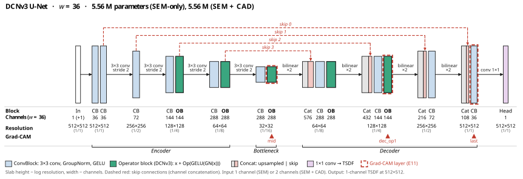

<sub><b>Figure 4.</b> The U-Net with DCNv3 operator blocks at width 36. Dashed red boxes mark the six layers visualised in the Grad-CAM analysis (Section 8). Diagrams for the other operators are in <code>results/architecture/</code>.</sub>

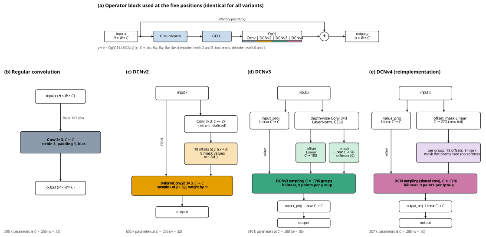

<sub><b>Figure 5.</b> (a) The residual operator block, identical at all five positions. (b–e) The operator Op for each variant.</sub>
</div>

Early experiments (E4–E9) matched the **total parameter count** across operators, which forced different channel widths. From E16 onward every operator runs at the **same width** (*w* = 36), with a standard-convolution control at *w* = 32 to isolate the effect of width.

| Model (width *w*) | Parameters (SEM-only input) | Learned sampling offsets | Batch-1 latency¹ |
|---|:--:|:--:|:--:|
| Conv, *w* = 32 | 5.60 M | no | **4.76 ms** |
| Conv, *w* = 36 | 7.09 M | no | – |
| DCNv2, *w* = 36 | 7.37 M | yes | 6.31 ms (*w* = 32) |
| DCNv3, *w* = 36 | 5.56 M | yes | 11.88 ms |
| DCNv4, *w* = 36 | **5.55 M** | yes | 11.42 ms |

<sub>¹ Measured on the earlier SEM + CAD models. DCNv3 and DCNv4 run through PyTorch reference implementations because the official DCNv4 CUDA operator did not build on this system, so latency is not a fair comparison between operators.</sub>

## 3 · Experimental protocol

The simulated data come from LithoBench's MetalSet and ViaSet (training and validation). **StdMetal (271 tiles) and StdContactTest (165 tiles) form a held-out test set** of unseen standard-cell layouts. All model selection uses validation data. Each frozen configuration is evaluated on the test set **once**. Unless stated otherwise, results are at 8 frames and inside the training exposure range. Seeds are independent training runs; where several exist, the mean and range are reported.

For E11–E17 the hypothesis, the single change, the metrics and a numerical acceptance gate were written to [docs/ROADMAP.md](docs/ROADMAP.md) **before** any run. A failed gate is reported as a result and is never relaxed afterwards.

| Experiment | Purpose | Data | Outcome |
|:-:|---|:-:|---|
| E1 | Validate the simulator and its ground truth | Sim. | Truth recovered to 0.018 px |
| E2 | Characterise registration error | Sim. | 0.3 px against the printed pattern, ~2.6 px against the design |
| E3 | Establish a calibrated classical baseline | Sim. | TMU-style 6.73 nm |
| E4 | Select an operator on validation data | Sim. | DCNv3 selected; standard conv statistically tied |
| E5 | Test-set metrology of all methods | Sim. | ~4× dose reduction; registration dominates EPE |
| E6 | Effect of supplying the design (CAD) as input | Sim. | No accuracy gain; reduced sensitivity |
| E7 | Roughness (LER/LWR) and local CD uniformity | Sim. | Learned models under-report roughness by ~5% |
| E8 | Measurement confidence | Sim. | Seed spread does not rank errors |
| E9 | Transfer to real SEM defects | Real | DCNv3 ahead of conv on every seed |
| E10 | C++/CUDA edge-refinement kernel | HW | 62× speed-up |
| E11 | Explainability (Grad-CAM, sampling offsets) | Sim. + real | Offsets are not edge-seeking |
| E12 | Bias-aware registration | Sim. | Adopted |
| E13 | Auxiliary edge-offset head | Sim. | Rejected |
| E14 | Roughness-spectrum loss | Sim. | Rejected |
| E15 | Monte Carlo SEM validation | – | Deferred |
| E16 | Operators at equal width | Sim. + real | Rejected on simulation; accepted on Carinthia-S (DCNv3, DCNv4) |
| E17 | Second real dataset (IC wiring) | Real | Rejected for all operators; DCNv4 marginally below the gate |

---

## 4 · Results on simulated SEM

<details><summary><b>4.1 Simulator validation and baseline (E1–E3): ground truth recovered to 0.018 px</b></summary>


Before any model is trained, the simulator must reproduce its own ground truth, and the classical baseline must be properly tuned. Otherwise later comparisons would be meaningless. The checks below confirm that truth is recovered to a small fraction of a pixel, that a known edge offset produces the expected bias, and that the brightest point of the SEM edge profile is not the physical edge. This last point is the reason a calibrated edge model is required.

| Check | Result |
|---|:--:|
| Noise-free truth recovery (~4,560 edge points) | 0.018 px median error |
| Known bloom offset of +1 / −1 px | Measured bias −1.017 / +1.038 px |
| Bright-peak position relative to the true edge | −0.60 px |
| Registration error against the printed pattern / against the design | 0.28–0.32 px / ~2.6 px (median) |
| Uniform +3 nm pattern shift | Measured as −0.7 to 0.0 nm (absorbed by registration) |
| Classical tracer on test: slope, TMU-style, precision (2 → 64 frames) | 0.995, 6.73 nm, 3.05 → 0.88 nm |

The last two registration rows matter later. Registration against the design is less accurate than against the printed pattern, because printing moves edges away from the design. A uniform shift of the whole pattern is removed by registration and is therefore invisible to EPE. Sensitivity is consequently tested with exposure-like and local edge changes.

</details>

<details><summary><b>4.2 Operator selection (E4): DCNv3 selected; standard convolution statistically tied</b></summary>


The four operators were trained under identical budgets and compared on validation data with a selection metric fixed in advance (mean TMU-style of CD and contact gauges at 8 frames). Paired bootstrap intervals show whether differences exceed tile-sampling noise.

| Model (seed 1, parameter-matched) | Selection metric (nm) | Difference to best, 95% CI |
|---|:--:|:--:|
| **DCNv3** | **5.49** | – |
| Conv (U-Net) | 5.53 | +0.03 (−0.04 … +0.11) |
| DCNv4 | 5.53 | +0.04 (+0.00 … +0.07) |
| DCNv2 | 5.56 | +0.07 (+0.03 … +0.10) |
| Classical | 6.29 | +0.80 (+0.41 … +1.16) |

DCNv3 was selected and frozen before test evaluation. The interval for standard convolution includes zero, so on simulated data the two are statistically indistinguishable. All learned models clearly outperform the classical tracer.

</details>

<details><summary><b>4.3 Test-set metrology (E5): ~4× dose reduction; registration dominates EPE</b></summary>


Table 4.3 reports the frozen configurations on the held-out test set. The last column is the operational result: the number of frames each method needs to match the classical tracer's precision at 64 frames.

| Method | Seeds | Slope | TMU-style (nm) | Precision 3σ, 2 / 64 frames (nm) | Failure | Frames to match classical at 64 |
|---|:--:|:--:|:--:|:--:|:--:|:--:|
| Classical | – | **0.995** | 6.73 | 3.05 / 0.88 | 6.8% | 64 |
| Conv (U-Net) | 3 | 0.993 | 6.30 | 2.31 / 0.47 | **4.2%** | 16–17 |
| DCNv3 | 3 | 0.993 | 6.29 | **2.24** / 0.45 | **4.2%** | **14–17** |
| DCNv2 | 1 | 0.994 | 6.30 | 2.29 / 0.45 | 4.3% | 16 |
| DCNv4 | 2 | 0.994 | **6.28** | 2.27 / **0.44** | **4.2%** | 15 |

The learned models reduce the noise-induced spread by 25% at 2 frames and by about half at 64 frames. This translates into a **roughly fourfold dose reduction** at equal precision, and they also have a lower failure rate. Their total uncertainty improves less (6.3 vs 6.7 nm), because it is dominated by a systematic per-image component examined in E13. Figure 6 shows the error distribution after the registration improvement of E12.

<div align="center">
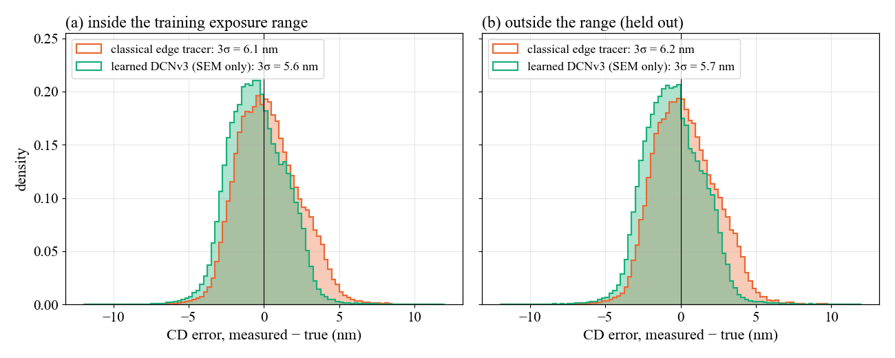

<sub><b>Figure 6.</b> Distribution of CD error (measured minus true) on the test set at 8 frames with bias-aware registration, inside and outside the training exposure range.</sub>
</div>

The same test set also separates the contribution of registration. Replacing the estimated registration with the exact one shows how much of the EPE error is caused by misalignment rather than by the edge model.

| Registration (test, seed 1) | CD failure, outside range | EPE TMU-style (nm) | EPE slope |
|---|:--:|:--:|:--:|
| Classical, CAD template | 47.6% | 8.17 | 0.850 |
| Classical, ideal | 3.8% | 3.05 | 0.991 |
| DCNv3, CAD template | 46.0% | 8.25 | 0.848 |
| DCNv3, ideal | **1.2%** | **2.66** | **0.974** |

> [!IMPORTANT]
> **Registration is the dominant source of EPE error.** With exact registration, EPE uncertainty falls from 8.25 to 2.66 nm, and nearly half of all CD measurements fail outside the training exposure range because the design template no longer matches the printed pattern. This result motivated E12.

</details>

<details><summary><b>4.4 Design as model input (E6): no accuracy gain, reduced sensitivity</b></summary>


Supplying the design layout as an additional input channel is common practice, but it risks teaching the model to reproduce the design rather than measure the wafer. The slope of measured against true values detects this: a model that leans on the design under-reports real deviations.

| DCNv3 | Seeds | CD TMU-style (nm) | Contact-CD slope | EPE slope |
|---|:--:|:--:|:--:|:--:|
| SEM + CAD | 3 | 6.27–6.31 | 0.948 – 0.955 | 0.848 – 0.854 |
| **SEM only** | 2 | 6.30 | **0.968 – 0.969** | **0.861 – 0.863** |

The design input gives no accuracy benefit, and every SEM-only seed has a higher slope than every SEM + CAD seed. The model with design input under-reports real contact-size changes by about 2%. All subsequent experiments therefore use **SEM-only input**.

</details>

<details><summary><b>4.5 Roughness (E7): learned contours under-report LER by ~5%</b></summary>


Line-edge roughness (LER) and line-width roughness (LWR) are small, high-frequency edge variations. They are a known weakness of smoothing-based edge models. The table compares measured and true roughness at 64 frames, where noise is negligible.

| Roughness bias at 64 frames (relative to truth) | Classical | Conv (U-Net) | DCNv3 |
|---|:--:|:--:|:--:|
| LER, σ = 1 nm | **+0.2%** | −5.0% | −5.7% |
| LER, σ = 2 nm | **+0.4%** | −6.0% | −4.5% |
| LWR, σ = 2 nm | **0.0%** | −6.8% | −5.1% |

The learned contours are **smoother than the true edges by about 5%**, while the classical tracer is unbiased. Roughness reported by the learned models therefore needs a calibrated correction factor. E14 tested whether this can be fixed during training. Local CD uniformity is over-estimated by every method (10.1–11.4 nm measured against 8.3 nm true), and the excess is systematic rather than noise.

</details>

<details><summary><b>4.6 Confidence (E8): only the any-seed-failure flag is useful</b></summary>


A practical metrology system must flag unreliable measurements. Two confidence signals were tested: the disagreement between three independently trained models, and the quality of the edge profile.

| Confidence signal | Rank correlation with absolute error | Useful |
|---|:--:|:--:|
| Seed disagreement + edge-profile quality | −0.07 … +0.11 | No |
| Flag: any of three seeds failed | CD RMS error 19.3 → 2.1 nm at 80% coverage | Yes |

Graded confidence does not identify the larger errors. Only the binary rule of rejecting gauges where any model failed is effective.

</details>

---

## 5 · Results on real SEM

Real SEM images have no exact ground truth for CD, so the real datasets are used as **segmentation** benchmarks. They test whether the operator comparison holds on real image statistics: real noise, charging, contrast and geometry.

| Dataset | Content | Images | Pixel size | Labels | Used in |
|---|---|:--:|:--:|---|:--:|
| [Carinthia-S](https://zenodo.org/records/16895427) | Defects on unpatterned wafers, six classes | 4,591 | – | Defect masks | E9, E16 |
| [Max Planck IC metal-2](https://doi.org/10.17617/3.HY5SYN) | Metal-2 wiring of a commercial chip (128 nm node), backscattered electrons, 15 keV | 321 labelled | 14.65 nm | Track polygons, via circles | E17 |

<a id="real-data-limits"></a>

> [!WARNING]
> **Limitations of the real-data evaluation**
> - **Image only.** Neither dataset includes the design layout, so registration, EPE and the design-input question cannot be tested on real data.
> - **Carinthia-S** is a defect-segmentation benchmark. Its rarest classes have one to eight test images, and it is not a CD benchmark.
> - **Max Planck** covers the wiring of **a single chip** and is not resist CD-SEM data. Its labels were produced by thresholding with manual correction. They lie **1–3 px (15–45 nm) from the visible edge** and use integer coordinates, so **absolute dimensional accuracy cannot be verified**; only differences between models on the same labels are meaningful.
> - **Single acquisitions.** Without repeated frames, true precision and roughness cannot be measured. Duplicate vias and missing tracks at image borders are possible. Only the central 80% × 80% of each image is used, split by image (225 / 48 / 48).
> - The operator differences observed (0.1–0.3 Dice points) are of the same order as the label uncertainty.

<details><summary><b>5.1 Wafer defects, Carinthia-S (E9): DCNv3 ahead of standard convolution on every seed</b></summary>


Defects such as pits, particles and scratches have irregular outlines, unlike the smooth simulated features. They are therefore a plausible case for deformable sampling. All operators were trained under identical budgets.

<div align="center">
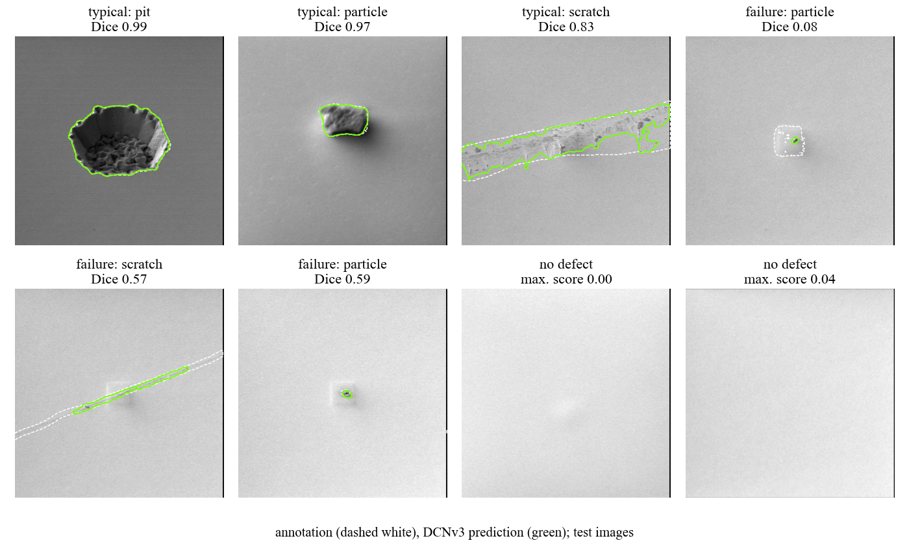

<sub><b>Figure 7.</b> Carinthia-S test images with the DCNv3 prediction: one median case per main defect class, the three lowest-scoring cases, and two defect-free images.</sub>
</div>

| Operator (parameter-matched) | Seeds | Test Dice, defect images | Capture / false-alarm rate |
|---|:--:|:--:|:--:|
| Conv (U-Net) | 3 | 0.9514 (0.9500–0.9525) | 100% / 2.9–8.8% |
| **DCNv3** | 3 | **0.9562** (0.9558–0.9569) | 100% / 2.9–5.9% |
| DCNv2 | 1 | 0.9499 | 100% / 2.9% |
| DCNv4 | 1 | 0.9529 | 100% / 2.9% |

DCNv3's lowest seed exceeds the best standard-convolution seed. Under parameter matching, however, DCNv3 ran at width 36 and the convolution at width 32. The gain could therefore be a width effect, which E16 tests directly. Failures concentrate on very small particles and fragmented scratches.

</details>

<details><summary><b>5.2 IC wiring, Max Planck metal-2 (E17): learned models halve width error; no operator passes the gate</b></summary>


E17 repeats the equal-width comparison of E16 on a second, structurally different real dataset: dense interconnect tracks and vias. A threshold baseline tuned on validation data provides a classical reference. Track width is measured per connected component, and a width failure is a missed component or an error above 44 nm (3 px).

| Model | Val Dice | Boundary F1 (2 px) | Edge distance (nm) | Width MAE (nm) | Width failure | Test Dice |
|---|:--:|:--:|:--:|:--:|:--:|:--:|
| Classical threshold | 0.9214 | 0.747 | 28.8 | 41.6 | 38.2% | 0.9211 |
| Conv, *w* = 32 | 0.9523 | 0.919 | 15.9 | 25.5 | 19.4% | 0.9509 |
| Conv, *w* = 36 (reference) | 0.9523 | 0.919 | 16.0 | 25.4 | 19.4% | 0.9509 |
| DCNv2, *w* = 36 | 0.9530 | 0.921 | 15.7 | 25.4 | 19.1% | 0.9516 |
| DCNv3, *w* = 36 | 0.9528 | 0.920 | 15.8 | 25.3 | 19.1% | 0.9515 |
| **DCNv4, *w* = 36** | **0.9549** | **0.927** | **15.1** | **24.6** | **18.2%** | **0.9537** |

The pre-registered gate required a Dice gain of at least 0.003 over the width-matched convolution, on the mean and on every individual seed:

| Gain over Conv *w* = 36 (val Dice) | Seed 1 | Seed 2 | Seed 3 | Mean | Gate |
|---|:--:|:--:|:--:|:--:|:--:|
| DCNv2 | +0.0003 | +0.0011 | +0.0006 | +0.0007 | Not met |
| DCNv3 | +0.0012 | +0.0000 | +0.0003 | +0.0005 | Not met |
| DCNv4 | +0.0028 | +0.0023 | +0.0029 | +0.0026 | Not met (marginal) |

All learned models outperform the classical threshold by a wide margin: width error falls from 42 to 25 nm and width failures fall by half. Among the operators, **DCNv4 leads on every seed and on every accuracy metric**, including the once-evaluated test set, but its mean gain falls just short of the threshold and is recorded as a failure. DCNv3, which passed on Carinthia-S, shows no advantage here. Simulator-trained models applied without retraining reach Dice 0.68–0.82, which confirms a substantial gap between simulated and real SEM.

</details>

---

## 6 · Edge-refinement kernel (E10)

Classical edge refinement samples the image along the normal at every edge point, an operation dominated by memory access. It was implemented in C++/OpenMP, in CUDA with manual bilinear interpolation, and in CUDA using the GPU's hardware texture filtering.

| 4096 px image, 10⁶ edge points | Kernel only | Including transfer |
|---|:--:|:--:|
| C++/OpenMP, 48 threads | 108.2 ms | – |
| PyTorch `grid_sample` | 38.8 ms | 43.5 ms |
| CUDA, manual bilinear | 6.60 ms | 11.8 ms |
| **CUDA, texture filtering** | **1.75 ms** | **7.2 ms** |

Texture filtering is the fastest path, but it uses 8-bit interpolation weights. It agrees with a float64 reference to 0.008 px on SEM data, yet produces a 5.4 px outlier on synthetic data, so the manual path (4.5 × 10⁻⁵ px) is the numerically safe choice. Sorting points into 32 px tiles improves locality further (0.29 ms with textures). For small workloads (10⁴ points) the image upload makes the GPU five times slower than the CPU.

---

## 7 · Pre-registered follow-up experiments (E11–E17)

After the first ten experiments, each open question was converted into one experiment that changes a single component. The table records what motivated each experiment, the hypothesis, the acceptance gate fixed in advance, and the outcome.

| # | Observation that motivated it | Hypothesis | Single change | Acceptance gate | Outcome |
|:-:|---|---|---|---|---|
| E11 | Deformable operators help on real defects (E9) but not on simulation (E4/E5) | Deformable sampling concentrates on edges | Grad-CAM at all operator blocks; sampling-offset maps | Diagnostic only | Offsets are not edge-concentrated |
| E12 | EPE 8.25 nm vs 2.66 nm with exact registration; 46% failures outside range (E5) | Template matching fails when printing changes feature size | Joint search over shift and global edge bias | Out-of-range failure ≤ 50% of baseline; EPE not worse | **Adopted**: failures 43.5% → 2.6%, EPE 7.75 → 5.29 nm |
| E13 | Uncertainty at 64 frames ≈ at 8 frames, so the floor is not noise; 91% of CD error is per image and tracks the edge-bloom offset (r = −0.98) | The per-image offset can be learned from the image | Auxiliary head predicting the offset | TMU −0.30 nm and R² ≥ 0.5 | **Rejected**: TMU −0.02 nm, R² = −0.008 |
| E14 | Learned contours under-report roughness by ~5% (E7) | Training does not penalise smoothing | Roughness-spectrum loss (weight 0.05) | Absolute LER bias ≤ 2.5% | **Rejected**: 4.6% |
| E15 | The simulator may be too regular to separate operators | A Monte Carlo electron simulator would | – | – | Deferred |
| E16 | E4/E9 matched parameters, so operators ran at different widths | The real-SEM gain of E9 is a width effect | All operators at width 36, plus a width-32 control | Simulated precision ≤ 0.95 × conv; real Dice ≥ +0.003 on every seed | Simulated: **rejected** (2–3% gain). Carinthia-S: **accepted** for DCNv3 and DCNv4 |
| E17 | The E16 real-SEM gain rests on one dataset | The gain generalises to other real SEM | Same comparison on Max Planck IC wiring | Real Dice ≥ +0.003 on every seed; no regressions | **Rejected** for all; DCNv4 marginal (+0.0026) |

<details><summary><b>7.1 Bias-aware registration (E12): adopted; EPE 8.3 → 5.2 nm</b></summary>


When the exposure changes, every printed feature grows or shrinks, and a template rendered from the unmodified design no longer matches. The bias-aware method renders templates over a range of global edge biases and selects shift and bias jointly.

| Validation, SEM-only DCNv3, 8 frames | CAD template | Bias-aware | Exact |
|---|:--:|:--:|:--:|
| CD failure outside the training range | 43.5% | **2.6%** | 1.9% |
| EPE TMU-style, inside range (nm) | 7.75 | **5.29** | 2.91 |
| CD TMU-style, inside range (nm) | 6.71 | **6.02** | 5.56 |
| Registrations off by more than 3 px | 50.5% | **16.7%** | – |

| Test set, 8 frames, seed 1 | CD TMU-style (nm) | CD failure inside / outside | EPE TMU-style (nm) | EPE slope |
|---|:--:|:--:|:--:|:--:|
| Learned, CAD template | 6.32 | 4.6% / 46.9% | 8.33 | 0.862 |
| **Learned, bias-aware** | **5.56** | **1.0% / 2.1%** | **5.15** | **0.953** |
| Classical, CAD template | 6.73 | 6.8% / 47.6% | 8.17 | 0.850 |
| Classical, bias-aware | 6.12 | 2.5% / 4.0% | 5.25 | 0.951 |

With the improved registration, learned and classical EPE agree (5.15 vs 5.25 nm), which shows that the earlier EPE gap was caused by registration. The learned model retains its precision advantage (0.44 vs 0.89 nm at 64 frames). The estimated global bias also tracks the true exposure shift to within 1.4 px, so the registration doubles as an exposure monitor.

</details>

<details><summary><b>7.2 Edge-offset head and roughness loss (E13, E14): both rejected</b></summary>


E13 tested whether the remaining CD floor, a per-image offset between the bright edge peak and the physical edge, can be predicted from the image. E14 tested whether a loss on the edge-roughness spectrum prevents contour smoothing.

| E13 (validation, SEM-only DCNv3, 8 frames) | Baseline | + offset head |
|---|:--:|:--:|
| CD TMU-style, exact registration (nm) | 5.562 | 5.539 |
| CD TMU-style, bias-aware registration (nm) | 6.015 | 5.994 |
| R² of the predicted offset | – | −0.008 |

| E14 (validation, 64 frames) | Reference | + spectrum loss |
|---|:--:|:--:|
| Signed LER bias, σ = 1 nm (line/space) | −4.9 … −5.7%¹ | −4.7% |
| CD TMU-style, bias-aware registration (nm) | 6.015 | **5.950** |

<sub>¹ SEM + CAD conv and DCNv3 models. The retrained SEM-only baseline failed on many line/space gauges (a seed-specific failure identified in E16), so it cannot serve as the roughness reference.</sub>

The offset is not recoverable from the image (R² ≈ 0). For an uncalibrated edge model it is therefore irreducible, and in production it would be removed by calibration against reference metrology such as cross-section TEM or AFM. Removing it would reduce CD 3σ from about 5.6 to 1.7 nm (estimated from the variance decomposition, not measured). The spectrum loss did not close the roughness gap.

</details>

<details><summary><b>7.3 Operators at equal width (E16): no simulated gain; real gain for DCNv3 and DCNv4</b></summary>


| Model (width) | Parameters | CD precision 3σ, 8 fr (nm) | CD precision 3σ, 2 fr (nm) | CD TMU-style (nm) | CD failure | Low-contrast RMSE (nm) | Carinthia-S val Dice |
|---|:--:|:--:|:--:|:--:|:--:|:--:|:--:|
| Conv (32) | 5.60 M | 1.335 | 2.449 | 5.99 | **1.7%** | 2.33 | 0.9456 |
| Conv (36) | 7.09 M | 1.314 | 2.378 | 5.98 | 1.8% | 2.25 | 0.9446 |
| DCNv2 (36) | 7.37 M | 1.283 | 2.344 | 5.98 | 1.8% | 2.38 | 0.9455 |
| DCNv3 (36) | 5.56 M | 1.272 | 2.347 | 5.98 | **1.7%** | **2.23** | **0.9485** |
| DCNv4 (36) | **5.55 M** | **1.270** | **2.341** | **5.96** | 1.8% | 2.40 | 0.9477 |

Widening the convolution from 32 to 36 channels does not change the real-SEM result. DCNv3 and DCNv4 outperform it on Carinthia-S with 22% fewer parameters, so the E9 gain was not a width effect. On simulated data, the deformable operators improve precision by 2–3%, which is about the size of the width effect itself (1.6%) and below the 5% gate. Total uncertainty stays at 5.96–5.99 nm for every model, consistent with the edge-offset floor identified in E13.

</details>

---

## 8 · Explainability (E11)

Gradient-weighted class activation maps (Grad-CAM) show which image regions each layer relies on for its output. Sampling-offset maps show how far the deformable operators move their sampling points. Both were computed at all five operator blocks and at the last decoder layer, for the same models and images. The figures share one layout:

| Element | Convention |
|---|---|
| Rows | Conv *w* = 32, Conv *w* = 36, DCNv2, DCNv3, DCNv4 (top to bottom) |
| Columns | Input; operator blocks at 1/4, 1/8, 1/16 (encoder and bottleneck), 1/8 and 1/4 (decoder) resolution; last decoder layer; sampling offsets of the decoder 1/4 block |
| Colour scale | Each map is normalised to its own maximum, so the location of high values is meaningful but their absolute level is not |
| Explained output | Summed foreground logits (real SEM) or summed predicted edge positions over CD gauges (simulated SEM) |

<div align="center">

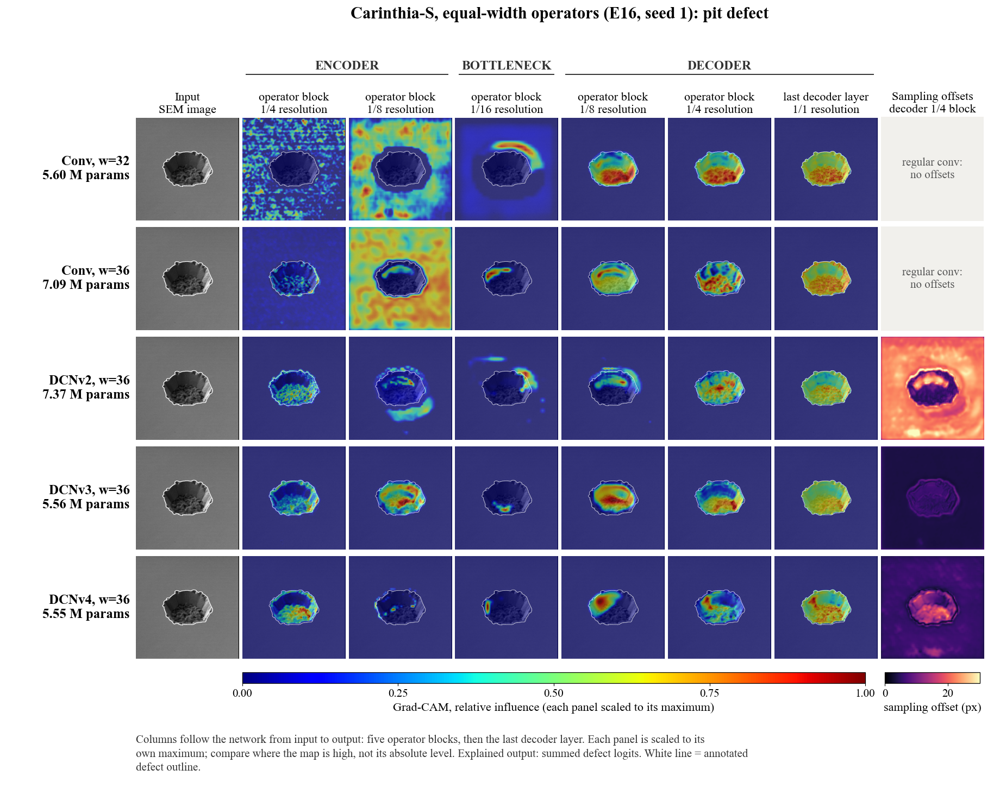

<sub><b>Figure 8.</b> Carinthia-S, pit defect.</sub>

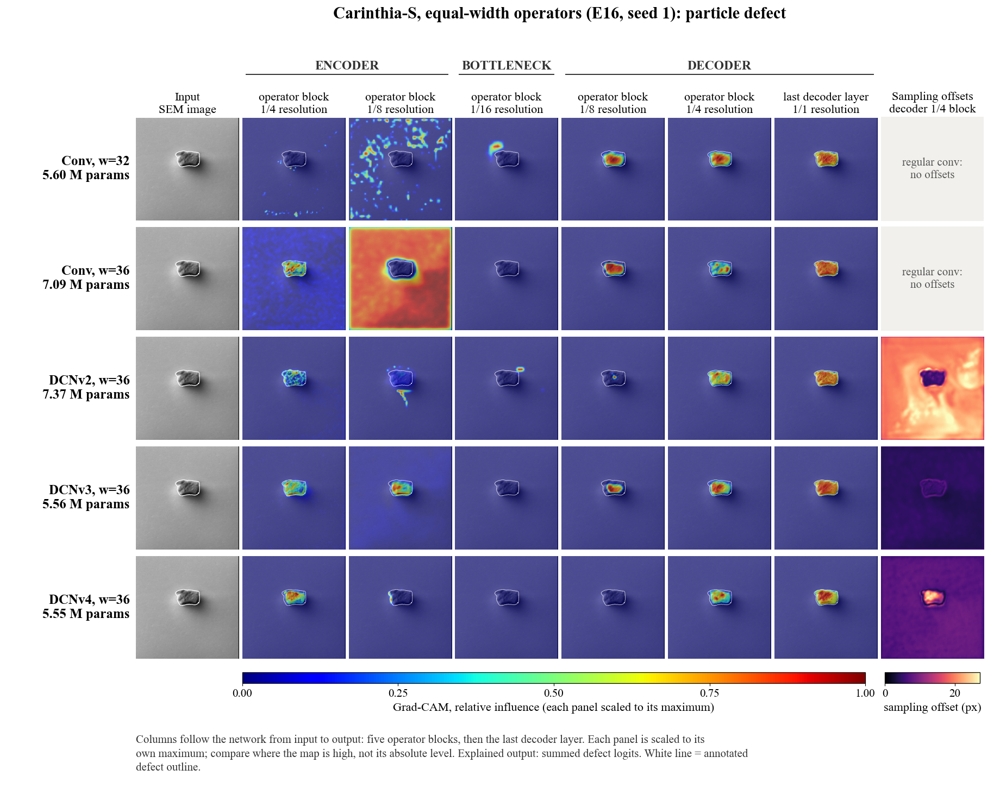

<sub><b>Figure 9.</b> Carinthia-S, particle defect.</sub>

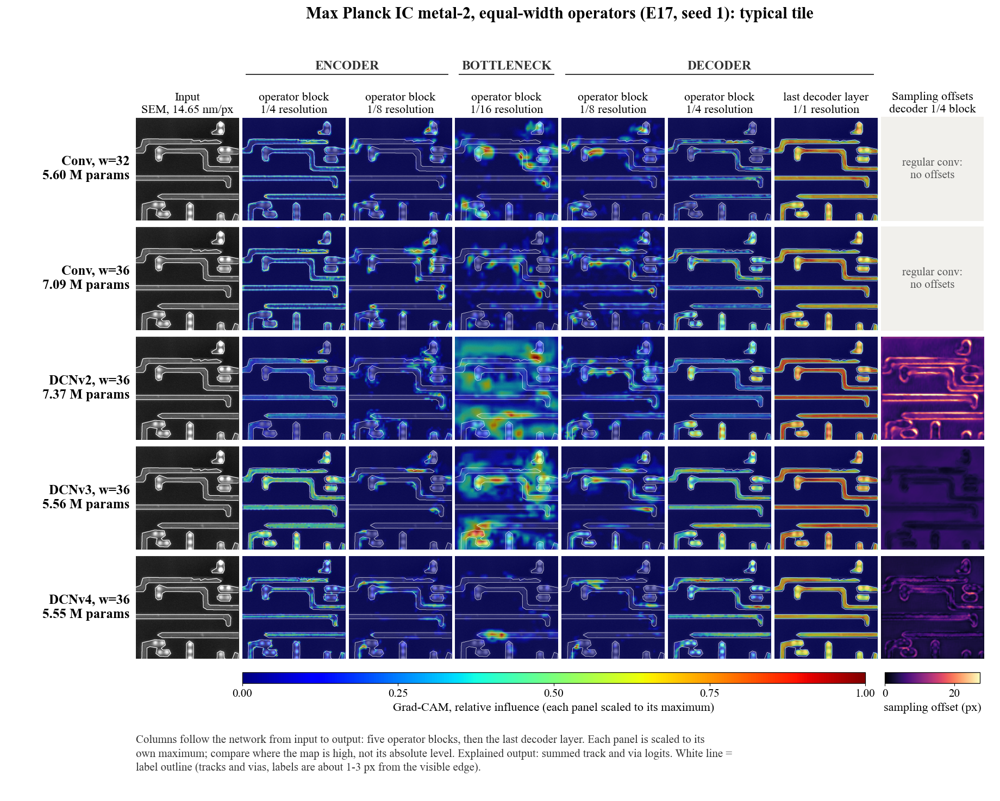

<sub><b>Figure 10.</b> Max Planck metal-2, tile with median Dice.</sub>

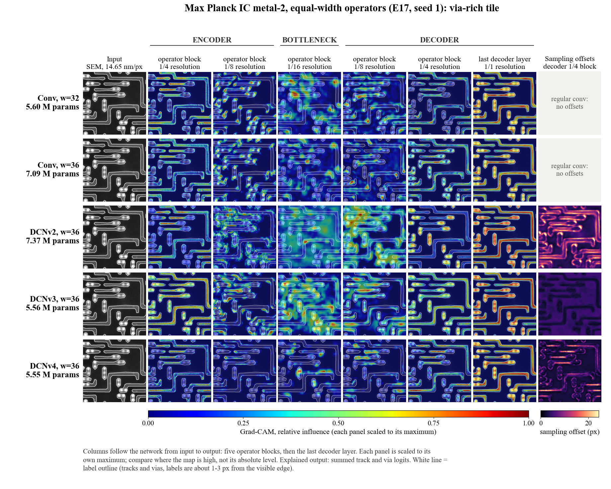

<sub><b>Figure 11.</b> Max Planck metal-2, tile with the highest via density.</sub>

</div>

Two statistics summarise the maps over many test tiles. *Edge enrichment* is the share of activation within 4 px of an edge divided by the share expected by chance. *Offset near/far* compares the mean sampling displacement near edges with that far from edges. An edge-seeking operator would show a ratio clearly above one.

| Mean over test tiles, seed-1 models | Conv-32 | Conv-36 | DCNv2 | DCNv3 | DCNv4 |
|---|:--:|:--:|:--:|:--:|:--:|
| Last layer, edge enrichment: simulated | **3.9** | 2.1 | 2.7 | 1.7 | 2.1 |
| Last layer, edge enrichment: Carinthia-S | 24.1 | 24.2 | **25.2** | 24.9 | 24.4 |
| Last layer, edge enrichment: Max Planck | **1.37** | 1.31 | 1.27 | 1.32 | 1.34 |
| Last layer, activation inside features (all datasets) | 0.97–1.00 | 0.97–1.00 | 0.97–1.00 | 0.97–1.00 | 0.97–1.00 |
| Sampling offset near / far from edges (px): simulated | – | – | 8.6 / 11.3 | 3.3 / 3.6 | 6.4 / 7.6 |
| Sampling offset near / far (px): Carinthia-S | – | – | 12.5 / 21.4 | 6.2 / 4.5 | 5.5 / 7.7 |
| Sampling offset near / far (px): Max Planck | – | – | 14.8 / 7.3 | 3.4 / 4.1 | 4.5 / 3.8 |

At the output layer, all operators concentrate essentially all of their activation inside the features, on every dataset. The deformable sampling offsets are not systematically larger near edges: the ratio changes direction between operators and datasets. The maps therefore offer **no mechanistic explanation** for the small real-SEM advantage. Intermediate layers vary strongly between training seeds, so no per-layer conclusion is drawn. With design input (E6), the bottleneck attends much less to feature interiors (3% vs 37% of activation), and the design channel receives 6–9% of the input attribution.

<sub>All Grad-CAM figures (simulated MetalSet and ViaSet for E4, E6, E13/E14 and E16; Carinthia-S scratch, pit and particle for E9 and E16; Max Planck typical, hard and via-rich tiles) and per-tile statistics are in <a href="results/gradcam/">results/gradcam/</a>.</sub>

---

## 9 · Summary of findings

| Finding | Evidence |
|---|:--:|
| **Learned contour models reduce the required dose about fourfold** at equal CD precision, with lower uncertainty and failure rate than a calibrated classical tracer. | E5 |
| **Registration is the largest single error source for EPE.** Bias-aware registration reduces EPE uncertainty from 8.3 to 5.2 nm and out-of-range failures from 47% to 2%. | E5, E12 |
| **The remaining CD accuracy floor is a per-image edge-offset ambiguity** (91% of error variance) that cannot be inferred from the image and is not affected by architecture. It requires calibration against reference metrology. | E13, E16 |
| **Deformable convolutions do not improve simulated metrology** beyond the effect of width. On real SEM they give a small gain that depends on the dataset: DCNv4 leads on both real datasets, DCNv3 on one, DCNv2 on neither. | E4, E9, E16, E17 |
| **Supplying the design as input reduces sensitivity** to real changes without improving accuracy. | E6 |
| **Learned contours under-report roughness by about 5%**, and a spectrum loss does not correct it. A calibrated correction factor is needed. | E7, E14 |
| **Seed disagreement is not a usable confidence measure**; rejecting gauges where any model fails is. | E8 |
| **Training-seed variance is comparable to many of the effects studied**, so single-seed comparisons are unreliable in this setting. | E4, E16, E17 |
| **The CUDA texture kernel is 62× faster** than a 48-thread CPU implementation for large workloads, with a known precision trade-off. | E10 |

## 10 · Limitations

| Area | Limitation |
|---|---|
| Simulated SEM | A controlled forward model, not an electron–matter simulation. It does not model charging, resist shrinkage, drift or tool matching. The Monte Carlo validation (E15) was deferred. |
| Technology node | LithoBench corresponds to 32/45 nm-class layouts; no claim is made for advanced nodes. |
| Real SEM | Segmentation only, without CD, EPE or roughness truth; see the [real-data limitations](#real-data-limits). |
| Seeds | Two to three seeds for the main comparisons; single seeds for some early models (DCNv2 in E4/E5) and for E12–E14. |
| Latency | DCNv3 and DCNv4 run through PyTorch reference code, so speed is not compared fairly across operators. |

Further detail: [docs/LIMITATIONS.md](docs/LIMITATIONS.md), [docs/RESULTS.md](docs/RESULTS.md), [docs/ROADMAP.md](docs/ROADMAP.md) (pre-registrations and gate evaluations), [docs/METROLOGY_QA.md](docs/METROLOGY_QA.md).

## 11 · Reproduction

```bash
python -m venv .venv
.venv/Scripts/python -m pip install -r requirements.txt   # Linux: .venv/bin/python

bash run_all.sh --data    # environment, LithoBench and Carinthia-S (~15 min)
bash run_all.sh --smoke   # tests and a one-minute end-to-end pass on four tiles
bash run_all.sh           # E1–E10 end to end (~12 h on one GPU); E11–E17: see "Individual steps"
```

| Dataset | Source | Location | Size |
|---|---|---|:--:|
| LithoBench | [github.com/shelljane/lithobench](https://github.com/shelljane/lithobench) | `data/lithobench/` | 14.7 GB |
| Carinthia-S | [zenodo.org/records/16895427](https://zenodo.org/records/16895427) | `data/carinthia/` | 139 MB |
| Max Planck IC metal-2 (manual download) | [doi:10.17617/3.HY5SYN](https://doi.org/10.17617/3.HY5SYN) | `data/maxplanck/dataset/` | 6.4 GB |
| Simulated validation and test sets | Generated locally | `results/raw/` | ~7 GB |

No pretrained weights are required; all models are trained from scratch through a GPU job queue. Step-by-step instructions are in [RERUN.md](RERUN.md).

<details><summary><b>Individual steps</b></summary>

```bash
python -m pytest tests                              # 49 tests (kernel tests need the built extension)
python src/sem_sim.py --m2-report                   # E1 simulator checks
python src/evaluate.py baseline                     # E2, E3, E7 classical baseline
python tools/run_queue.py start --runs configs/runs/screen_*.yaml   # training through the GPU queue
python src/confidence.py --runs <s1> <s2> <s3> --tag dcnv3          # E8
python src/carinthia.py split | train --run <yaml> | aggregate      # E9
cuda\build.bat && python benchmarks/bench_kernel.py parity          # E10
python tools/e12_analysis.py <run> [--classical]    # E12 registration
python tools/e16_analysis.py                        # E16 gates
python tools/maxplanck_prepare.py                   # E17 data preparation and split
python src/maxplanck.py train --run configs/runs/maxplanck/e17_maxplanck_dcnv4_w36_s1.yaml
python src/maxplanck.py classical | zeroshot | aggregate            # E17 references and gates
python tools/make_gradcam.py run all && python tools/make_gradcam.py teaser   # E11 Grad-CAM figures
python tools/make_dashboard.py && python tools/make_banner.py       # Figure 1 and banner
python tools/make_readme_figures.py && python tools/make_architecture_diagrams.py
```
</details>

Tested on an NVIDIA RTX PRO 5000 Blackwell (sm_120) and an AMD Threadripper PRO 7965WX, with Python 3.10, CUDA 12.8 and MSVC on Windows.

## 12 · Repository structure

```
sem-cd-epe-metrology/
├── src/
│   ├── sem_sim.py           # ground-truth field and SEM forward model (GPU)
│   ├── registration.py      # design-template and bias-aware registration
│   ├── gauges.py            # CD, EPE and contact gauges; GDS export
│   ├── classical.py         # classical edge measurement and 1D refinement
│   ├── operators.py         # Conv, DCNv2, DCNv3, DCNv4 operator blocks
│   ├── models.py            # U-Net with TSDF output
│   ├── train.py · measure.py · evaluate.py · confidence.py
│   ├── explain.py           # Grad-CAM, offset maps, attribution
│   ├── carinthia.py         # real SEM: Carinthia-S
│   └── maxplanck.py         # real SEM: Max Planck IC metal-2
├── cuda/                    # C++/OpenMP and CUDA kernels, pybind11, CMake
├── tools/                   # job queue, gate analyses, figure generation
├── configs/                 # default.yaml and one file per training run
├── tests/                   # 49 tests
├── results/                 # all tables and figures referenced here
└── docs/                    # pre-registrations, detailed results, limitations
```

## 13 · References

1. S. Zheng et al. *LithoBench: Benchmarking AI Computational Lithography for Semiconductor Manufacturing.* NeurIPS Datasets and Benchmarks, 2023. [Code](https://github.com/shelljane/lithobench)
2. C. Kofler et al. *Carinthia dataset.* Zenodo, 2024. [Data](https://zenodo.org/records/16895427)
3. Integrated-circuit SEM dataset with metal-2 track and via annotations. Edmond, the research data repository of the Max Planck Society, CC BY 4.0. [doi:10.17617/3.HY5SYN](https://doi.org/10.17617/3.HY5SYN)
4. X. Zhu, H. Hu, S. Lin, J. Dai. *Deformable ConvNets v2: More Deformable, Better Results.* CVPR, 2019.
5. W. Wang et al. *InternImage: Exploring Large-Scale Vision Foundation Models with Deformable Convolutions.* CVPR, 2023. [Code](https://github.com/OpenGVLab/InternImage)
6. Y. Xiong et al. *Efficient Deformable ConvNets: Rethinking Dynamic and Sparse Operator for Vision Applications.* CVPR, 2024. [Code](https://github.com/OpenGVLab/DCNv4)
7. O. Ronneberger, P. Fischer, T. Brox. *U-Net: Convolutional Networks for Biomedical Image Segmentation.* MICCAI, 2015.
8. R. R. Selvaraju et al. *Grad-CAM: Visual Explanations from Deep Networks via Gradient-based Localization.* ICCV, 2017.

## License

The code is released under the [MIT License](LICENSE). Datasets and model weights remain under their own licenses.

<div align="center">
<sub>All numbers in this document are produced by the code in this repository and stored in <code>results/</code>. CD and EPE results are obtained on simulated SEM images.</sub>
</div>
