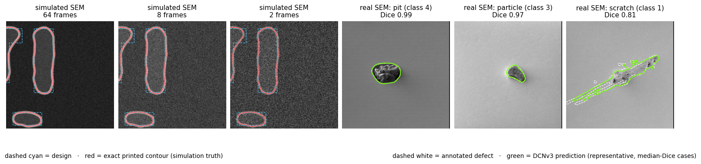
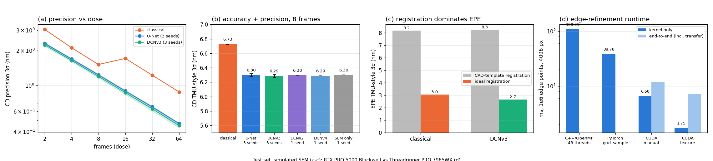
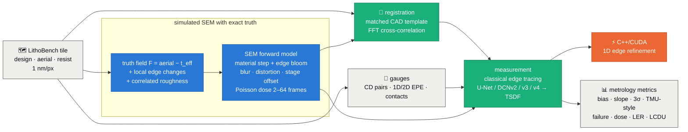
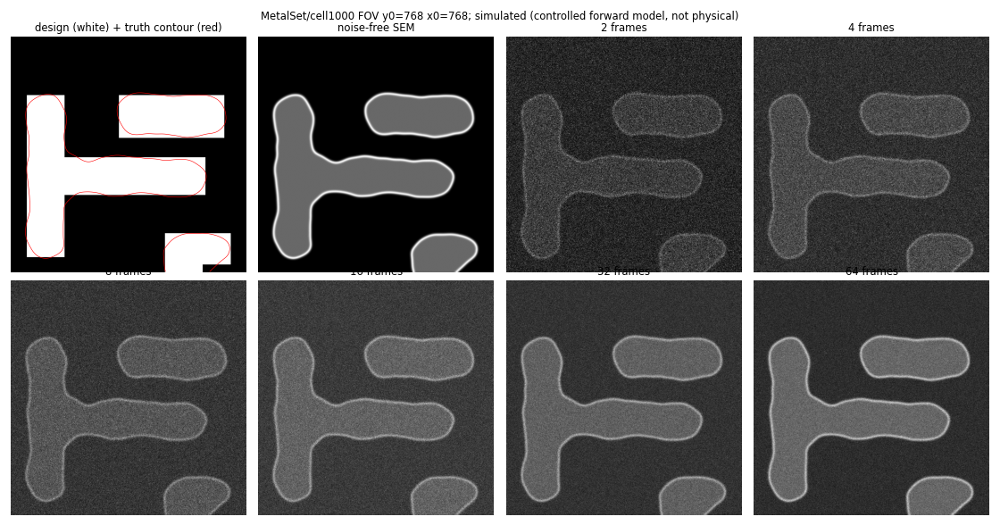
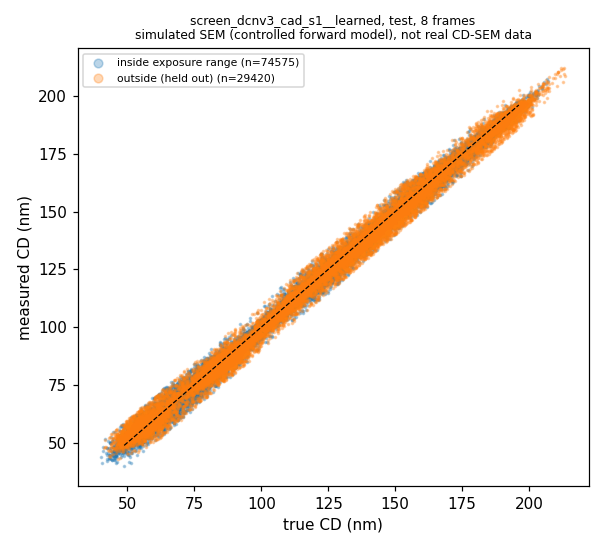
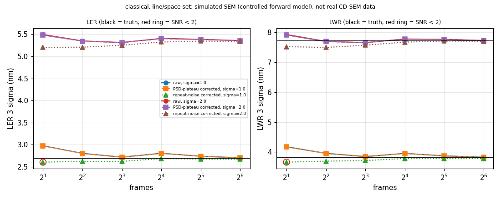
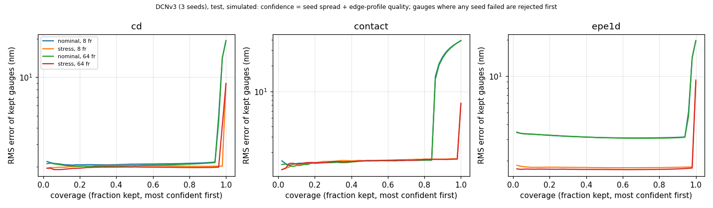
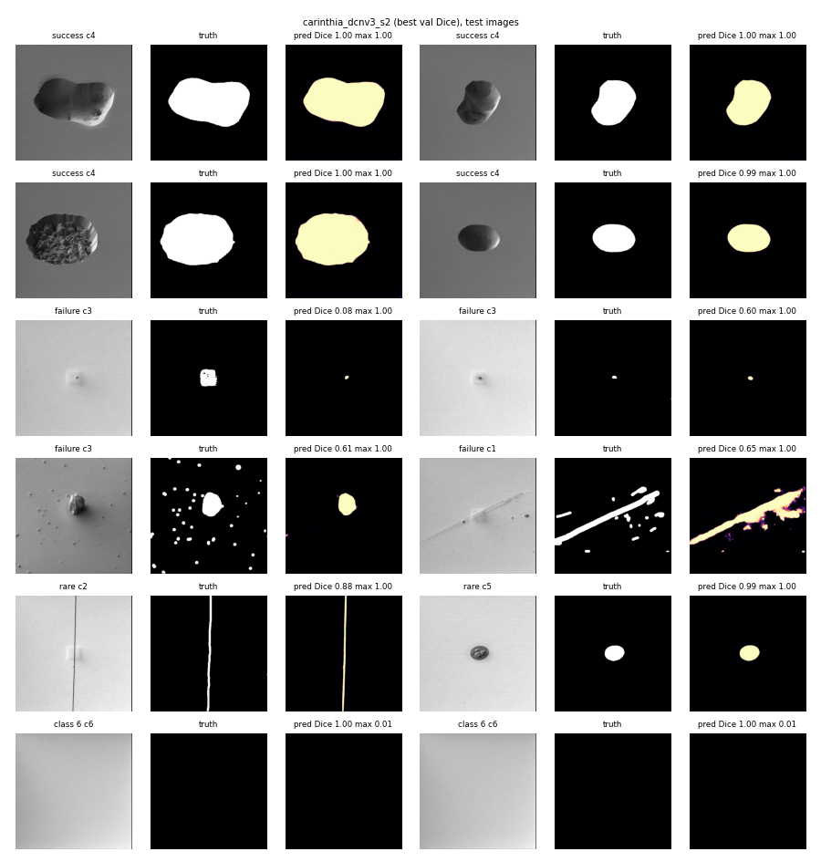
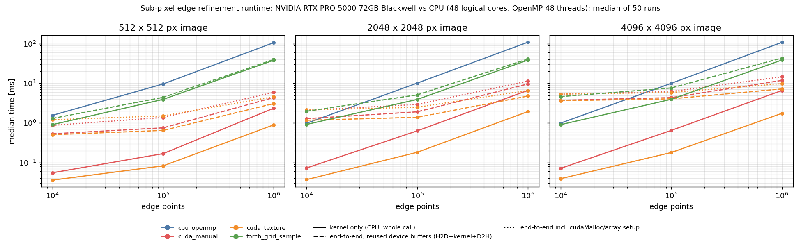

<div align="center">

# 🔬 sem-cd-epe-metrology

### Design-based CD and edge-placement metrology from low-dose SEM images, with deep contour models and a C++/CUDA edge kernel

*Built and evaluated on a **simulated SEM with exact ground truth** (public LithoBench lithography data), then checked on **real SEM defect images** (Carinthia-S).*

<br/>


[](LICENSE)


<br/>



<sub><b>Left:</b> simulated SEM at 64 → 2 frames with the design (dashed cyan) and the exact printed contour (red). <b>Right:</b> real SEM defects from Carinthia-S with the DCNv3 prediction (green) vs the annotation (dashed white); representative median-Dice cases per class.</sub>

</div>

---

## TL;DR

- **What:** a design-based CD-SEM metrology engine. It aligns a low-dose SEM image to its layout, extracts sub-pixel contours, measures **critical dimension (CD)** and **edge placement error (EPE)** on design-defined gauges, flags failed measurements, and runs the per-edge refinement step in a **custom C++/CUDA kernel**.
- **How we tested it:** **10 experiments in two phases**, scored the way a metrology engineer would (bias, regression slope, precision 3σ, TMU-style uncertainty, dose response, failure rate), not by segmentation IoU.
  - **Phase 1, simulated SEM:** an SEM forward model on top of LithoBench lithography data gives **exact edge truth** under exposure-like process changes, local edge changes, roughness and 2–64-frame doses. 436 unseen standard-cell tiles form the test set.
  - **Phase 2, real SEM:** the same network shells segment defects in **4,591 real SEM images** (Carinthia-S).
- **Key results** (all measured):
  - 📉 Learned contour models reach the baseline's 64-frame CD precision (0.88 nm 3σ) at **14–17 frames, about 4x lower dose**, and **0.45 nm at 64 frames**.
  - 🎯 CD TMU-style **6.29 nm vs 6.73 nm** and failure rate **4.2% vs 6.8%** against a validation-tuned, offset-calibrated classical edge tracer.
  - 🧭 **Registration, not the edge model, limits EPE:** EPE TMU-style **8.2 nm → 2.7 nm** with ideal registration.
  - ⚡ The CUDA texture kernel refines **1M edge points in 1.75 ms** on a 4096 px image, **62x** faster than 48 CPU threads (**11x** including transfer).
- **The honest twist:** deformable convolutions (DCNv2/v3/v4) gave **no measurable gain** on simulated metrology. U-Net and DCNv3 overlap across 3 seeds. Yet on **real SEM defects** DCNv3 won on every seed (Dice 0.956 vs 0.951). And the CAD input did not improve accuracy, but **slightly reduced sensitivity** to real contact-size changes.

<div align="center">



<sub>(a) CD precision vs dose (3-seed band). (b) CD TMU-style by method (y-axis starts at 5.5 nm; error bars = seed range). (c) EPE with CAD-template vs ideal registration. (d) Edge-refinement runtime. Rebuilt from <code>results/</code> by <code>python tools/make_dashboard.py</code>.</sub>

</div>

---

## 1 · The question

**Critical dimension (CD)** is the printed size of a feature; **edge placement error (EPE)** is the signed distance from a design edge to the printed edge. Design-based metrology aligns the SEM image to the layout and measures on gauges defined by the design. Lower electron dose raises throughput and reduces damage, but adds shot noise. That raises four engineering questions:

1. **Can a learned contour model measure CD/EPE better than classical edge tracing,** and at how much lower dose?
2. **Do deformable convolutions (DCNv2, v3, v4) help,** under matched parameters and training?
3. **Does feeding the design (CAD) to the model help, or does it pull measurements toward the design and hide real error?**
4. **Where does the error actually come from:** noise, the edge model, or registration?

A segmentation score cannot answer these. A model can reach high IoU and still be biased, insensitive to real process changes, or noisy at low dose, so every result here is a metrology metric against exact truth.

## 2 · What we built



| Component | What it does |
|---|---|
| 🔵 **Exact truth** (`src/sem_sim.py`) | The printed contour is the zero level set of a continuous field built from the LithoBench aerial image (8-bit aerial blended with logit(resist) near threshold). An effective-threshold sweep gives pattern-dependent CD changes (±12 nm in training, ±21 nm held out). Local programmed edge changes and correlated roughness are added on top. |
| 🔵 **SEM forward model** (`src/sem_sim.py`) | Material contrast, an edge-bloom peak with configurable offset, Gaussian beam blur, low-order distortion, stage offset, Poisson shot noise for 2–64 frames plus detector noise. GPU-batched; a seed reproduces image and truth exactly. |
| 🟢 **Registration** (`src/registration.py`) | Renders the CAD with the nominal SEM model and aligns it by FFT cross-correlation. The same estimate is used by every method. |
| 🟢 **Gauges** (`src/gauges.py`) | Paired CD on straight design segments, 1D/2D EPE probes along design normals, 32-ray contact gauges; GDS export with a round-trip check. |
| 🟢 **Classical baseline** (`src/classical.py`) | Gaussian filter, bloom-peak search, outer-slope threshold; smoothing and threshold tuned per dose on validation and an edge offset calibrated, like a real recipe. |
| 🟢 **Learned models** (`src/models.py`, `src/operators.py`) | One U-Net shell (5.6 M parameters) predicting a truncated signed distance map from SEM + registered CAD. Only the operator block changes: Conv, DCNv2, DCNv3, DCNv4. |
| 🟠 **C++/CUDA kernel** (`cuda/`) | The 1D edge refinement in C++/OpenMP, CUDA with manual bilinear sampling, and CUDA with hardware texture filtering; pybind11 interface; float64 parity checks. |

## 3 · The experiments

| # | Experiment | Data | Question it answers |
|:-:|---|:-:|---|
| **E1** | Truth and simulator checks |  | Does a direct profile measurement recover the defined truth? Does a known bloom offset give the expected bias? |
| **E2** | Registration |  | How well is the SEM aligned to the design, and why is a uniform shift not an EPE test? |
| **E3** | Classical baseline |  | How good is a fairly tuned, calibrated edge tracer? |
| **E4** | Operator screening (validation) |  | Which deformable operator to select, before touching the test set? |
| **E5** | **Test-set metrology** |  | Slope, offset, 3σ, TMU-style, failure and dose benefit for every method |
| **E6** | CAD vs SEM-only |  | Does CAD help, or does it hide real change? |
| **E7** | Roughness and LCDU |  | Does noise correction recover true LER and LCDU? |
| **E8** | Confidence |  | Does seed spread + profile quality predict which measurements are wrong? |
| **E9** | **Carinthia-S defects** |  | Do the same operators help on real SEM images? |
| **E10** | C++/CUDA kernel |  | How fast is the edge refinement, and does texture filtering keep parity? |

---

## 4 · Phase 1: simulated SEM 

The simulated images have **exact edge truth**, so accuracy, precision and sensitivity can be measured directly. Training uses MetalSet and ViaSet; **StdMetal (271) and StdContactTest (165) are held out as the test set** and were evaluated once per frozen configuration.



<sub>Design (white) with the exact printed contour (red), the noise-free SEM render, and the same field at 2–64 frames.</sub>

### E1 · Truth and simulator checks
| Check | Result |
|---|:--:|
| Noise-free truth recovery (direct profile measurement, ~4,560 edge points) | **0.018 px** median error |
| Known bloom offset of +1 / −1 px | bias **−1.017 / +1.038 px** |
| Peak location with material contrast, zero offset | **−0.60 px** (the bright peak is not the edge) |
| Exposure-like sweep, median CD change | +12.4 … −12.9 nm (training range), +20.7 / −21.4 nm (held out) |

### E2 · Registration
- Against a template of the **printed** pattern the registration recovers stage offset + distortion to **0.3 px** median.
- Against the **CAD** template the error is ~3 px median: LithoBench's printed vias are offset from the design by about (−1, +2) px, and line ends pull back. Uniform placement is unobservable by design-based registration.
- **A uniform pattern shift is absorbed:** a true +3 nm EPE change was measured as −0.7…+0.0 nm, so sensitivity is tested with exposure-like and local edge changes instead.

### E3 · Classical baseline
Filter σ and threshold were tuned per dose on validation (inside the exposure range only) and an edge offset of ≈2.0 px was calibrated. On the test set: CD slope **0.995**, TMU-style **6.73 nm**, precision **3.05 nm** (2 frames) → **0.88 nm** (64 frames).

### E4 · Operator screening (validation)
Selection metric fixed before training: mean validation TMU-style (CD + contacts) at 8 frames, full 120-tile validation set, paired tile bootstrap.

| Model (seed 1) | Selection metric (nm) | Paired Δ vs best (95% CI) |
|---|:--:|:--:|
| **DCNv3** | **5.49** | – |
| U-Net | 5.53 | +0.03 (−0.04 … +0.11), indistinguishable |
| DCNv4 | 5.53 | +0.04 (+0.00 … +0.07) |
| DCNv2 | 5.56 | +0.07 (+0.03 … +0.10) |
| Classical | 6.29 | +0.80 (+0.41 … +1.16) |

> [!NOTE]
> **DCNv3 was selected on validation** and the choice was frozen before any test evaluation. Adding a classical 1D profile refinement after the learned contour made every model worse (+0.52 … +0.55 nm), so it is reported but not used.

### E5 · Test-set metrology
CD gauges at 8 frames inside the exposure range, estimated registration. U-Net and DCNv3: mean (range) over 3 seeds; other rows are single-seed.

| Method | Seeds | Slope | TMU-style 3σ (nm) | Precision 3σ @ 2 / 64 fr (nm) | Failure | Frames to match baseline @ 64 |
|---|:--:|:--:|:--:|:--:|:--:|:--:|
| Classical | – | 0.995 | 6.73 | 3.05 / 0.88 | 6.8% | 64 |
| U-Net | 3 | 0.993 | 6.30 (6.28–6.32) | 2.31 / 0.47 | 4.2% | 16–17 |
| **DCNv3** | 3 | 0.993 | **6.29** (6.27–6.31) | **2.24 / 0.45** | **4.2%** | **14–17** |
| DCNv2 | 1 | 0.994 | 6.30 | 2.29 / 0.45 | 4.3% | 16 |
| DCNv4 | 1 | 0.994 | 6.29 | 2.28 / 0.44 | 4.4% | 15 |



**Registration decomposition (seed 1):**

| | CD failure outside the training range | EPE TMU-style (nm) | EPE slope |
|---|:--:|:--:|:--:|
| Classical, CAD-template registration | 47.6% | 8.17 | 0.850 |
| Classical, ideal registration | 3.8% | 3.05 | 0.991 |
| DCNv3, CAD-template registration | 46.0% | 8.25 | 0.848 |
| DCNv3, ideal registration | **1.2%** | **2.66** | **0.974** |

> [!IMPORTANT]
> **Registration is the dominant EPE error.** With ideal registration DCNv3 cuts EPE TMU-style from 8.25 to 2.66 nm. At outer exposure values the printed pattern departs from the design, the CAD-template registration mis-locks, and CD failures jump to ~46–48% for **every** method.

### E6 · CAD vs SEM-only
| DCNv3 (seed 1) | CD TMU-style (nm) | Contact-CD slope (95% CI) | EPE slope |
|---|:--:|:--:|:--:|
| SEM + CAD | 6.27 | 0.948 (0.941–0.954) | 0.848 |
| SEM only | 6.30 | **0.968** (0.962–0.974) | 0.861 |

CAD did **not** improve accuracy, and the contact-CD regression slope is lower with CAD: the model under-responds to real contact-size changes by about 2%. This is weak evidence (single seed for SEM-only; CI from tile resampling).

### E7 · Roughness and LCDU
- **LER** (classical, line/space set, σ = 1 nm): raw 2.98 nm vs true 2.70 nm (3σ) at 2 frames. The **PSD-plateau correction fails** because filtering and blur correlate noise along the edge; a **repeat-noise correction** gives 2.61 nm but is flagged unreliable (SNR 1.9 < 2).
- **LCDU** (test contacts): measured 10.1–11.1 nm vs true 8.3 nm for every method. The noise term is only 0.17–1.4 nm, so the excess is systematic per-image error, which noise correction cannot remove.

<details><summary><b>LER/LWR plot</b></summary>


</details>

### E8 · Confidence
Confidence = seed spread across the 3 DCNv3 models + edge-profile quality. Spearman correlation with |error| is **−0.07 … +0.11** on nominal and stress sets: **the graded confidence does not rank errors.** Risk-coverage still improves (CD RMS error 19.3 → 2.1 nm at 80% coverage), but only because gauges where **any** seed failed are rejected first.



---

## 5 · Phase 2: real SEM defects 

### E9 · Carinthia-S
**[Carinthia-S](https://zenodo.org/records/16895427)** contains 4,591 real SEM images of defects on unstructured wafers in six classes; class 6 has no visible defect and serves as the nuisance set. It has **no CD/EPE truth**, so it tests the operators on real image statistics through defect segmentation.



<sub>Real Carinthia-S test images with annotation and DCNv3 prediction: successes, failures (small particles, multi-part scratches), the two rarest classes, and no-defect (nuisance) images.</sub>

**Setup:** SEM-only U-Net shell, BCE + soft Dice, identical budget for every operator; stratified split (test: 654 defect images, 34 no-defect images); checkpoint and detection threshold chosen on validation.

| Operator | Seeds | Test Dice (defect images) | Capture / nuisance |
|---|:--:|:--:|:--:|
| U-Net | 3 | 0.9514 (0.9500–0.9525) | 100% / 2.9–8.8% |
| **DCNv3** | 3 | **0.9562** (0.9558–0.9569) | 100% / 2.9–5.9% |
| DCNv2 | 1 | 0.9499 | 100% / 2.9% |
| DCNv4 | 1 | 0.9529 | 100% / 2.9% |

> [!IMPORTANT]
> **On real SEM images DCNv3 helped, slightly but consistently:** its worst seed (0.9558) beats U-Net's best (0.9525). Real-image noise is far below the simulator's and spatially correlated (relative noise 0.018 vs 0.08–1.06 simulated), which may be why the operator matters here but not in Phase 1. Classes 2 and 5 have one test image each, so per-class results for them are anecdotal.

---

## 6 · E10 · C++/CUDA edge refinement 

| 4096 px image, 1M edge points | Kernel only | End-to-end (incl. transfer) |
|---|:--:|:--:|
| C++/OpenMP, 48 threads | 108.2 ms | – |
| PyTorch `grid_sample` | 38.8 ms | 43.5 ms |
| CUDA, manual bilinear | 6.60 ms | 11.8 ms |
| **CUDA, texture filtering** | **1.75 ms** | **7.2 ms** |

- **Parity vs float64:** manual sampling max 4.5e-5 px; texture max 0.008 px on SEM data but a **5.4 px outlier** on synthetic data, caused by the hardware's 8-bit filter weights.
- **When it is not worth it:** for 1e4 points on a 4096 px image, uploading the image makes the GPU **5x slower** than the CPU.
- **Memory locality:** sorting points into 32 px tiles cuts the kernel to 0.68 ms (manual) and 0.29 ms (texture).



---

## 7 · What we learned

| | Takeaway | Evidence |
|:-:|---|---|
| ✅ | **Learned contour models give about 4x dose reduction at equal CD precision,** with lower TMU-style and failure rate. | E5 |
| ✅ | **The C++/CUDA kernel makes edge refinement ~62x faster** than 48 CPU threads, and PyTorch is not competitive. | E10 |
| ⚖️ | **Deformable convolutions:** no gain on simulated metrology, a small consistent gain on real SEM defects. | E4, E5, E9 |
| ⚖️ | **CAD input:** no accuracy gain, and a lower contact-CD slope, i.e. some pull toward the design. | E6 |
| ⚠️ | **Registration, not the edge model, dominates EPE,** and it fails outside the process window. | E2, E5 |
| ⚠️ | **Noise correction is not a free lunch:** PSD-plateau LER correction fails under correlated noise; LCDU excess is systematic. | E7 |
| ⚠️ | **Seed-spread confidence did not rank errors;** only the "any seed failed" flag was useful. | E8 |

---

## 8 · Reproduce

```bash
python -m venv .venv
.venv/Scripts/python -m pip install -r requirements.txt   # Linux: .venv/bin/python

bash run_all.sh --smoke   # tests + a ~1-minute end-to-end pass on 4 tiles (needs the datasets, see below)
bash run_all.sh           # full pipeline: data download, simulation, baselines, training through the GPU queue
```

| What | Where it comes from | Lands in | Size |
|---|---|---|---|
| Python deps (PyTorch 2.11 CUDA 12.8 wheels, NumPy, SciPy, gdstk, pybind11, …) | PyPI + download.pytorch.org via `requirements.txt` | `.venv/` | mostly PyTorch |
| LithoBench (MetalSet, ViaSet, StdMetal, StdContact) | [github.com/shelljane/lithobench](https://github.com/shelljane/lithobench) (Google Drive link in its README) | `data/lithobench/` | 14.7 GB |
| Carinthia-S | [zenodo.org/records/16895427](https://zenodo.org/records/16895427) | `data/carinthia/` | 139 MB |
| Simulated validation / test sets | generated locally from LithoBench | `results/raw/` | ~7 GB |

<details><summary><b>Run individual pieces</b></summary>

```bash
python -m pytest tests                              # 45 tests (kernel tests need the extension built)
python src/data_lithobench.py --audit               # dataset audit + tile splits
python src/sem_sim.py --m2-report                   # simulator truth checks (E1)
python src/evaluate.py cache --split val            # cache simulated validation set
python src/evaluate.py register --split val         # registration estimates
python src/evaluate.py baseline                     # classical baseline, registration, roughness, LCDU (E2, E3, E7)
python src/train.py --build-bank                    # training crop bank
python tools/run_queue.py start --runs configs/runs/screen_*.yaml   # training through the GPU queue
python src/confidence.py --runs <run_s1> <run_s2> <run_s3> --tag dcnv3   # E8
python src/carinthia.py split | train --run <yaml> | aggregate | noise  # E9
cuda\build.bat                                      # build the C++/CUDA extension (Windows: CMake + nvcc 12.8 + MSVC)
python benchmarks/bench_kernel.py parity            # E10 parity
python tools/make_dashboard.py                      # results/figures/hero.png
```
</details>

**Prerequisites:** Python 3.10, `bash` (Git Bash on Windows), an NVIDIA GPU with CUDA 12.8-compatible drivers. Building the kernel needs CMake (installed into the venv), nvcc 12.8 and a C++ compiler (MSVC on Windows). Tested on an RTX PRO 5000 Blackwell (sm_120) with an AMD Threadripper PRO 7965WX.

## 9 · Repository structure

```
sem-cd-epe-metrology/
├── src/
│   ├── data_lithobench.py   # LithoBench I/O, tile-level splits
│   ├── sem_sim.py           # exact truth field + SEM forward model (GPU)
│   ├── registration.py      # CAD template + FFT registration
│   ├── gauges.py            # CD / EPE / contact gauges, GDS export
│   ├── classical.py         # classical edge measurement + shared 1D refinement
│   ├── operators.py         # Conv / DCNv2 / DCNv3 / DCNv4 blocks
│   ├── models.py            # U-Net shell (TSDF output)
│   ├── train.py             # on-the-fly GPU training
│   ├── measure.py           # image + gauges -> measurements
│   ├── evaluate.py          # caching, metrics, bootstrap, roughness, LCDU
│   ├── confidence.py        # seed spread + profile quality, risk-coverage
│   ├── carinthia.py         # real-SEM defect pipeline
│   └── plots.py             # figures from saved results
├── cuda/                    # C++/OpenMP + CUDA kernels, pybind11 binding, CMake, build.bat
├── benchmarks/              # kernel parity + runtime benchmark
├── tools/                   # GPU job queue, concurrency pilot, operator table, dashboard
├── configs/                 # default.yaml (all parameters) + per-run configs
├── tests/                   # 45 tests: truth, registration, operators, kernel, Carinthia
├── third_party/             # vendored DCNv3 PyTorch operator (MIT) + DCNv4 license
├── results/                 # every table and figure quoted in this README
└── docs/                    # architecture, full results, limitations, metrology Q&A
```

<details><summary><b>Method details</b></summary>

- **Gauges:** CD = paired opposite edges on straight segments ≥ 10 px from corners; EPE1d on straight edges, EPE2d elsewhere; contacts = area-equivalent CD of 32 rays.
- **Failure:** invalid measurement or |error| > 10 nm. Bias and regression use non-failed gauges.
- **Precision:** per-gauge standard deviation over 20 noise seeds on fixed geometry, pooled RMS, ×3.
- **TMU-style:** 3 × residual standard deviation about the OLS line of measured vs simulated truth. Reference uncertainty is set to zero because the simulated truth is exact; a tool TMU needs a reference instrument and Mandel regression.
- **Dose benefit:** lowest frame count at which a method's CD 3σ reaches the classical 3σ at 64 frames (log-log interpolation).
- **Confidence intervals:** paired tile-level bootstrap (1000 resamples); they capture tile sampling, not training-seed variation.
- **Operators:** parameter counts matched within 10% (5.55–5.85 M) by adjusting the width; DCN sampling runs in float32 inside bf16 autocast. DCNv3 uses the official InternImage PyTorch path; DCNv4 is a PyTorch reimplementation of the module semantics because the official CUDA operator did not build on this setup.
- **Concurrency:** a pilot showed that two concurrent training runs add −2% (DCNv3) / +9% (U-Net) aggregate throughput, so training runs one at a time; CPU-bound evaluation jobs run in parallel.
</details>

## 10 · Limitations

- **Simulated SEM:** a controlled forward model, not an electron-matter simulator. No charging, resist shrinkage, focus variation, real scan distortion, drift or tool matching. Nothing here is validated on a production CD-SEM.
- **Node:** LithoBench is 32/45 nm-class data; no claim about advanced nodes.
- **Seeds:** U-Net and DCNv3 have 3 seeds; DCNv2, DCNv4 and the SEM-only model have 1. Learned-model roughness and a physics-based (Monte Carlo) SEM check were not run.
- **Real data:** Carinthia-S tests segmentation only; its rare classes have 1–8 test images.

More: [docs/LIMITATIONS.md](docs/LIMITATIONS.md) · full tables: [docs/RESULTS.md](docs/RESULTS.md) · design discussion (precision vs accuracy, TMU, CAD bias, edge models): [docs/METROLOGY_QA.md](docs/METROLOGY_QA.md)

## 11 · References

- **LithoBench:** S. Zheng et al. *LithoBench: Benchmarking AI Computational Lithography for Semiconductor Manufacturing.* NeurIPS 2023 Datasets and Benchmarks · [code](https://github.com/shelljane/lithobench)
- **Carinthia-S:** C. Kofler et al. *Carinthia dataset.* Zenodo, 2024 · [data](https://zenodo.org/records/16895427)
- **DCNv2:** X. Zhu, H. Hu, S. Lin, J. Dai. *Deformable ConvNets v2: More Deformable, Better Results.* CVPR 2019
- **DCNv3 / InternImage:** W. Wang et al. *InternImage: Exploring Large-Scale Vision Foundation Models with Deformable Convolutions.* CVPR 2023 · [code](https://github.com/OpenGVLab/InternImage)
- **DCNv4:** Y. Xiong et al. *Efficient Deformable ConvNets: Rethinking Dynamic and Sparse Operator for Vision Applications.* CVPR 2024 · [code](https://github.com/OpenGVLab/DCNv4)
- **U-Net:** O. Ronneberger, P. Fischer, T. Brox. *U-Net: Convolutional Networks for Biomedical Image Segmentation.* MICCAI 2015

## License

Code is released under the [MIT License](LICENSE). Model weights and datasets keep their own licenses.

<div align="center">
<sub>Every number in this README is produced by the code in this repository and stored in <code>results/</code>. CD/EPE results come from a simulated SEM. Values are rounded only for display.</sub>
</div>
